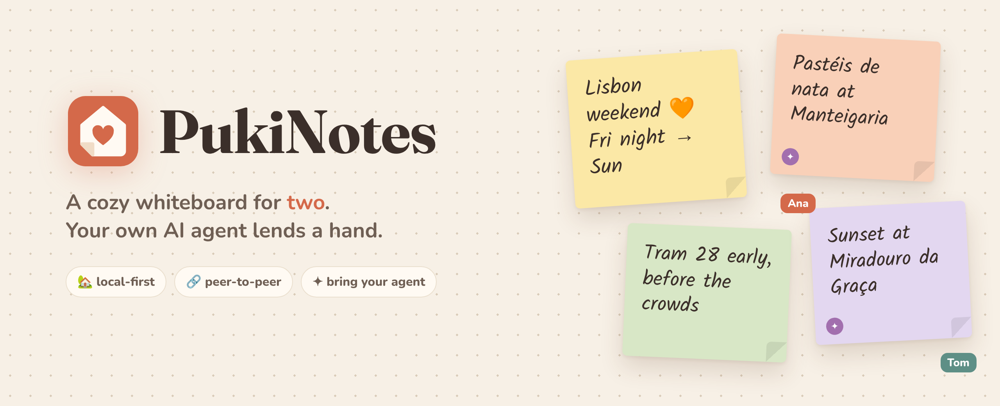

# PukiNotes brand

PukiNotes should feel like a kitchen table with a pile of sticky notes on it: warm, soft, handmade, a little
playful. Never corporate, never techy.

## Logo: the note house

A little house with a heart inside, and its bottom-left corner folded like a sticky note. Home, two people, notes.

- File: [`assets/logo.svg`](assets/logo.svg) (128 × 128, scales cleanly down to 16 px).
- Always on its terracotta tile. Don't recolor it, outline it, rotate it or put the house on its own.
- Leave clear space around it of at least a quarter of its width.
- With the wordmark: logo on the left, **PukiNotes** in Fraunces Bold, gap about a third of the logo's width.
  Write it as one word with a capital P and N: PukiNotes (not Puki Notes, not pukinotes).

## Colors

| | Name | Hex | Use |
|---|---|---|---|
|  | Terracotta | `#d4694a` | Brand, primary buttons, the logo tile |
|  | Terracotta deep | `#bf5a3d` | Hover and pressed |
|  | Blush | `#f7ddd0` | Soft highlights, selected tool |
|  | Paper | `#f7f0e6` | Canvas background (with a dot grid) |
|  | Cream | `#fffaf3` | Panels, cards, the house in the logo |
|  | Line | `#eadfce` | Borders and dividers |
|  | Ink | `#3b2f2a` | Text |
|  | Muted | `#8c7b6e` | Secondary text, icons |
|  | Sage | `#7a9a6b` | Online, saved, success |
|  | Agent plum | `#a26fae` | Everything the AI agent touches (✦) |

Sticky notes: butter `#fbe8a6`, peach `#f9d0b8`, mint `#d8e7c6`, lilac `#e3d7f0`, sky `#cfe4ef`.

Plum is reserved for the agent, so people can always tell at a glance what the AI did.

## Type

- **Fraunces** (600–700): the wordmark and headings. Soft, bookish serif.
- **Nunito** (600–800): everything in the interface. Rounded and friendly.
- **Kalam**: handwriting on sticky notes only.

All three are free on Google Fonts.

## Interface

- Icons first, words second. If a control needs a sentence to explain it, it belongs in a tooltip.
- Rounded everything (panels 16–22 px, buttons 10–14 px), warm soft shadows (`rgba(92,58,32,.12)`), no hard
  black lines.
- Settings live behind the gear. The canvas stays clear.

## Voice

Short, warm, plain. Talk like a friend leaving a note on the fridge.

- Say "Your boards stay as they are", not "No data migration is required".
- Say "Ana is away", not "Peer disconnected".
- No exclamation-mark pile-ups, no jargon, no blame. One emoji is fine; three is a lot.

## Files

| File | What |
|---|---|
| `assets/logo.svg` | The logo |
| `assets/banner.png` | README banner (2560 × 1040) |
| `assets/social-preview.png` | GitHub social preview (1280 × 640) |
| `assets/screenshot-*.png` | App screenshots |
