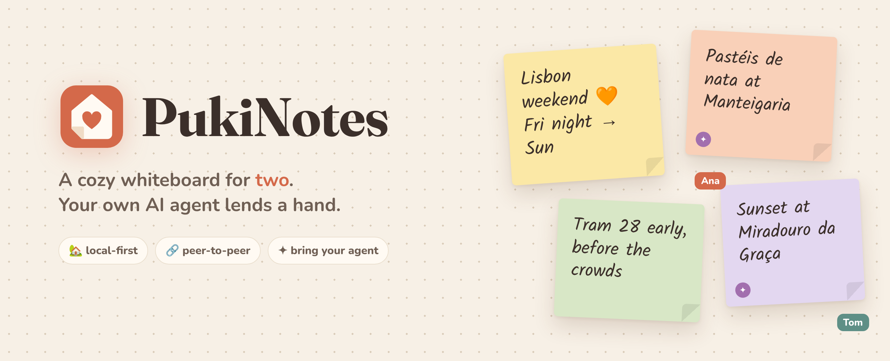
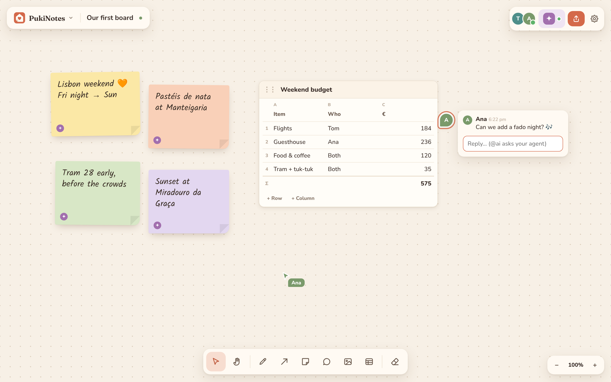
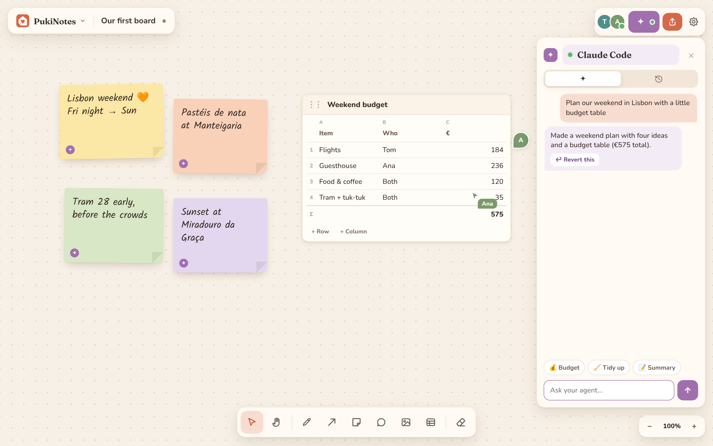

<p align="center">
  
</p>

<p align="center">
  <b>No accounts. No server. Just the two of you, a board, and your own AI helper.</b>
</p>

<p align="center">
  
</p>

## What it is

PukiNotes is an infinite whiteboard for two people: plan a trip, split a budget, keep a shared list.

- 🏡 **Local-first.** Your boards live on your computer, in `~/.pukinotes`.
- 🔗 **Peer-to-peer.** Boards sync straight between your two computers over tailcat. Share one code, that's it.
- ✦ **Bring your own agent.** Claude Code, Codex, Gemini CLI, Cursor… binds itself to PukiNotes and works on the
  board for you. Everything it does lands in History, and you can revert it in one click.
- ✍️ **All the cozy bits.** Sticky notes, pen with shape snapping, arrows, comments, photos, and tables with
  formulas you can resize like a spreadsheet.

## Start in one sentence

Point your AI agent at this repo and say:

> **launch PukiNotes**

Your agent reads [`AGENTS.md`](AGENTS.md), sets things up (Go is the only requirement), opens the app and binds
itself to it. Then ask it things in the ✦ panel, or write `@ai` in any comment on the board. That work runs in
**your** agent's session, on your plan. Your partner's `@ai` goes to **their** agent.

<p align="center">
  
</p>

## Using it

The app explains itself with icons; hover anything for a hint. The shortcuts:

| Key | Tool | | Key | Tool |
|---|---|---|---|---|
| **V** | Select | | **C** | Comment |
| **H** / drag empty space | Pan | | **I** / ⌘V | Image |
| **P** | Pen (pause to snap a shape) | | **T** | Table (`=SUM(C1:C4)` works) |
| **L** | Arrow | | **E** | Eraser |
| **N** | Sticky note | | ⌘Z / ⇧⌘Z | Undo / redo |

- **Share** (the orange button, top right) shows the board's code. It's always the same, so send it again any
  time. The ↻ button makes a new one and cancels the old. Paste your partner's code below it to join theirs.
- **Settings** (the gear) has your name and color, your partner's status, and the version. A dot on the gear
  means an update is ready: click **Update now** and PukiNotes pulls, rebuilds and restarts in a few seconds.
  Your boards aren't touched.

## By hand

```
go run ./cmd/pukinotes start      # opens PukiNotes in your browser
go run ./cmd/pukinotes doctor     # checks everything
go run ./cmd/pukinotes update     # same as Update now
go run ./cmd/pukinotes stop
```

## What's in the repo

- [`AGENTS.md`](AGENTS.md): the launch and binding procedure, written for agents (`CLAUDE.md` points to it)
- `cmd/pukinotes/`: the app. One Go program: local web server, tailcat peer sync, and the agent tools (MCP + CLI).
  The built UI is embedded.
- `web/`: UI source (Yjs + plain JS). Only needed if you change the UI.
- [`DESIGN.md`](DESIGN.md): design and architecture notes
- [`BRAND.md`](BRAND.md): logo, colors, type and voice
